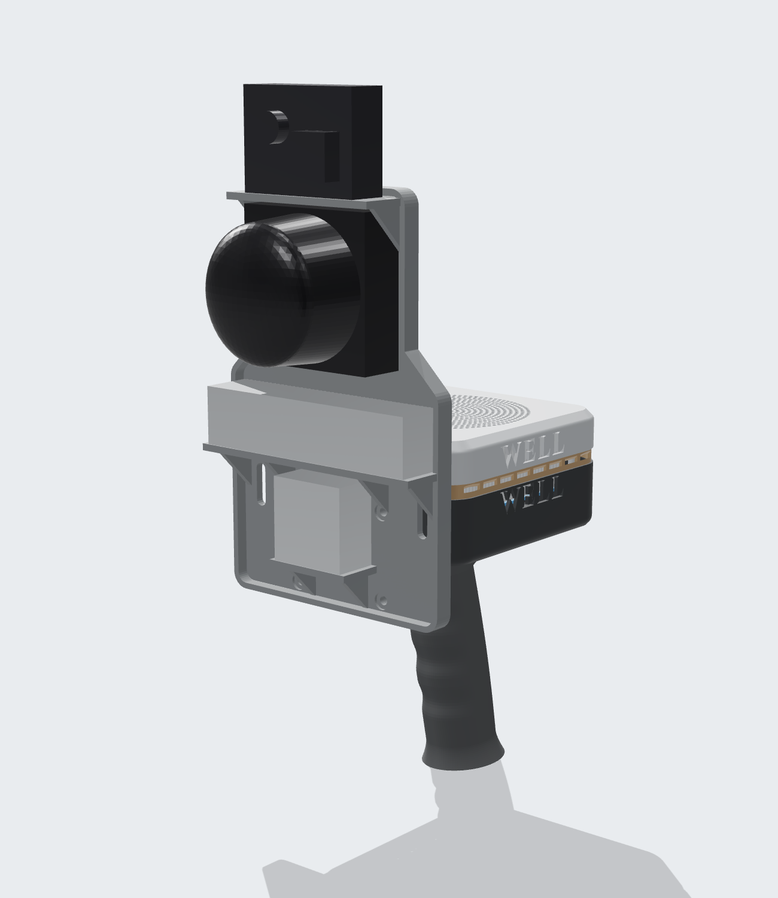
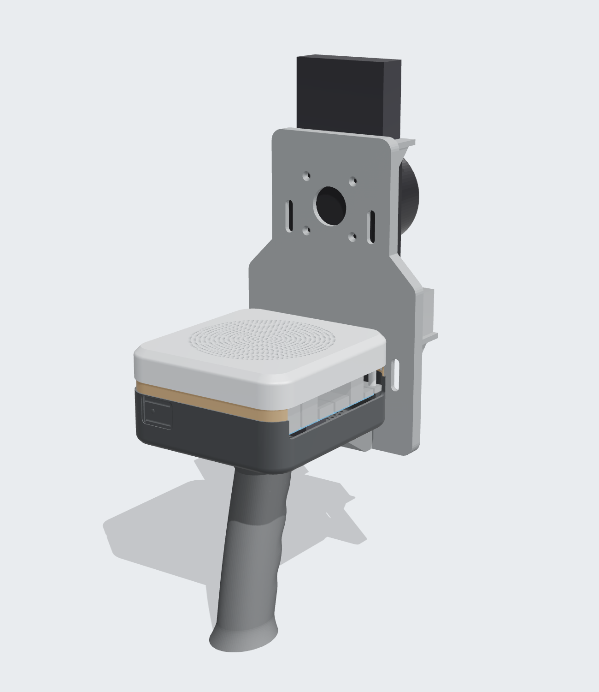
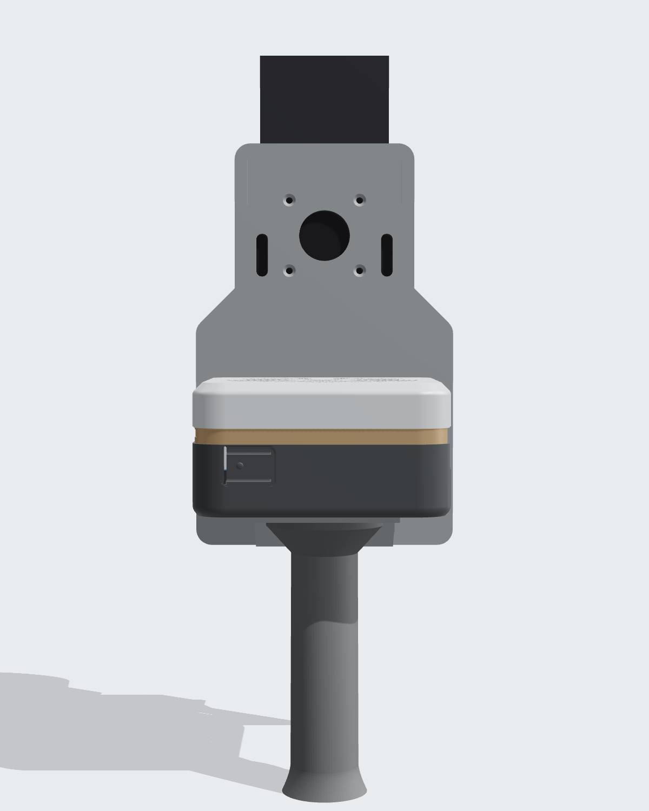

# Корпус сканера OPi6

Ручной сканер: лёгкий продуваемый корпус под Orange Pi 6 Plus, рукоять на байонете и площадка с лидаром Unitree L2 и камерами D455, D405 и MaixCAM2.



Корпус сделан по образцу Aurora: серебристая крышка с фаской и круглой решёткой, бронзовый пояс со щелями на стыке, тёмный низ. На стороне выдува насквозь прорезано WELL в два яруса: буквы и есть вентиляция.


- **Три печатные детали, ни одного винта в корпусе.** Низ, пояс, крышка. Плата лежит углами на площадках с бортиками, сверху её прижимают стойки крышки. Крышка держится на четырёх защёлках, которые проходят сквозь пояс и зажимают его.
- **Кнопка питания без пружин.** Гибкий язычок в левом борту, толкатель изнутри нажимает PWR на плате.
- **Продув.** Сверху круглая решётка над кулером (755 отверстий). Спереди, напротив рёбер радиатора, сквозные буквы WELL в крышке и в низу (≈ 245 мм² на ярус) и 8 щелей-жалюзи в поясе. В дне продув NVMe (615 отверстий). Сзади общий проём разъёмов.
- **Печать без поддержек.** Наклоны не круче 45°, это проверяется автоматически по сетке. Потолки прорезей букв — мосты не длиннее 9,4 мм.
- **Рукоять на байонете.** В дне гнездо: четыре положения через 90°, фиксация поворотом на 45°.

| | |
|---|---|
| Габарит | 127 × 118 × 61 мм |
| Масса (сплошные стенки 2 мм) | ≈ 123 г PLA/PETG, ≈ 106 г ASA (пояс ≈ 3 г) |
| Печатный габарит | низ 127 × 118 × 33 мм, пояс 125 × 115 × 7 мм, крышка 127 × 118 × 39 мм |


| Сзади: проём разъёмов | Слева: язычок кнопки |
|---|---|
|  |  |

| Разнесено: низ, пояс, крышка | Разрез: защёлки, поясок, стойки |
|---|---|
|  |  |

## Файлы

| Путь | Что это |
|---|---|
| `stl/scanner_case_bottom.stl` | Нижняя деталь, уже в положении для печати (дном на стол) |
| `stl/scanner_case_ring.stl` | Пояс, в положении для печати |
| `stl/scanner_case_lid.stl` | Крышка, уже в положении для печати (верхом на стол) |
| `stl/scanner_handle.stl` | Рукоять, стоя на торце |
| `stl/scanner_arm.stl` | Кронштейн площадки, на боку |
| `stl/scanner_sensor_plate.stl` | Площадка датчиков, тылом на стол |
| `case/fonts/` | Шрифт надписи Cinzel Black и его лицензия SIL OFL |
| `case/scanner_case.py` | Параметрическая модель корпуса: все размеры в `Params` |
| `case/scanner_rig.py` | Рукоять, кронштейн и площадка: все размеры в `Rig` |
| `case/build.py` | Сборка STL и GLB, проверки, отчёт |
| `docs/report.json` | Отчёт последней сборки: пересечения, зазоры, нависания, масса |
| `docs/viewer/` | 3D-просмотр (страница и `scanner_case.glb`) |

## Рукоять и площадка датчиков



Сканер смотрит вперёд площадкой. Она стоит у правого борта корпуса (если смотреть на разъёмы): там нет ни вентиляции, ни кнопки. Оператор держит рукоять сзади, кнопка питания смотрит на него. Надпись WELL выдувает влево, разъёмы — вправо.

- **Рукоять.** Длина 110 мм, наклон 12°, сечение 32 × 44 мм, канавки под пальцы. Вставляется в гнездо дна и доворачивается на 45° до щелчка. Под указательным пальцем гнездо под тактовую кнопку 12 × 12 для старта записи. Провод от неё идёт каналом внутри и выходит сзади, над рукой. В торце термовставка 1/4″-20 под штатив или люльку с повербанком.
- **Кронштейн.** Язык толщиной 5 мм зажат между дном корпуса и рукоятью. Лыски на шейке рукояти не дают ему провернуться, поэтому площадка всегда смотрит вперёд. Фланец 8 мм с четырьмя термовставками M4.
- **Площадка.** Снизу вверх: D405 на нижней полке, D455 на средней, лидар L2 на четырёх M3 с потаем с тыла, MaixCAM2 на верхней полке экраном к оператору. Камеры ставятся на винт 1/4″-20, пазы полок дают ±3 мм подстройки. По бокам пазы для кабелей.

| | |
|---|---|
| Габарит сканера | 206 × 132 × 358 мм |
| Масса с датчиками и платой | ≈ 0,93 кг (рукоять 92 г, кронштейн 49 г, площадка 75 г) |
| Центр масс | в 69 мм впереди середины рукояти, момент на кисть 0,63 Н·м |
| Печатный габарит | рукоять 77 × 56 × 137 мм, кронштейн 105 × 60 × 70 мм, площадка 206 × 132 × 34 мм |

| Сбоку | Поля зрения |
|---|---|
|  | Верхняя граница кадра D455 (65° по вертикали) проходит на 5 мм ниже корпуса лидара, у D405 запас 52 мм. Все камеры заканчиваются позади оптического центра L2 (X 114,7 против 121,5 мм) и не лезут в его полусферу. |

Повербанк в люльке под рукоятью уравновесит вылет вперёд. Люльки пока нет: её крепит 1/4″ в торце.

### Крепёж

| Что | Сколько | Куда |
|---|---|---|
| Термовставка M4 × 8 (Ø 5,6) | 4 | Фланец кронштейна |
| Винт M4 × 12 | 4 | Площадка к кронштейну |
| Винт M3 × 8 потайной | 4 | Лидар L2 к площадке |
| Винт 1/4″-20 × 10 | 3 | D405, D455, MaixCAM2 к полкам |
| Термовставка 1/4″-20 (Ø 7,9 × 11) | 1 | Торец рукояти |
| Тактовая кнопка 12 × 12 | 1 | Гнездо под пальцем |

## Замеры платы, заложенные в модель

| Замер | Значение | Как использован |
|---|---|---|
| Плата | 115 × 100 мм | По бокам 4 мм до стенки, у углов 1 мм, сзади 5,7 мм, спереди 8,2 мм под камеру выдува |
| Над платой (кулер) | 33 мм | Потолок крышки на 37 мм над платой: 4 мм воздуха под решёткой |
| Под платой (NVMe) | 14 мм | Дно на 18 мм ниже платы: 4 мм под лепестки рукояти |
| Кнопка PWR | слева от разъёмов, 12 мм от угла со стороны выдува | Язычок с толкателем в левом борту |
| Выдув | напротив разъёмов | Спереди надпись WELL и щели пояса, разъёмы в проёме сзади |

Система координат модели: Z = 0 — низ платы, X — вдоль ребра с разъёмами, разъёмы смотрят в −Y, выдув — в +Y. Кнопка на левом борту (−X).

## Сверить с платой до печати

Это допущения: их не было в замерах. Каждое — параметр в `Params`.

- `btn_z = 1.8`, `btn_protrude = 0.8`: центр толкателя PWR над верхом платы и выступ кнопки за край.
- `btn_from_corner = 12`: по фото центр кнопки может быть ближе, на 9–10 мм. Толкатель шириной 6 мм перекрывает оба случая.
- `conn_h = 17.5`: самый высокий разъём над верхом платы. От него зависит линия разъёма корпуса.
- `hole_inset = 3.5`: крепёжные отверстия от краёв. Углы 7 × 7 мм над и под платой должны быть свободны: там стойки крышки и площадки.
- `conn_corner = 5`: разъёмы идут вдоль ребра 115 мм и не подходят к углам ближе 5 мм.

По датчикам (параметры в `Rig`):

- `lidar_pcd = 51`: отверстия M3 лидара L2 на окружности Ø 51 мм под 45°. Сверьте с чертежом «Installation dimensions» в [руководстве L2](https://oss-global-cdn.unitree.com/static/Unitree%204D%20LiDAR%20L2%20User%20Manual.pdf).
- Резьба 1/4″ у D455 и D405 снизу посередине, у MaixCAM2 на нижнем торце. Пазы полок прощают ±3 мм.
- Задние отверстия D455 не используются: их размер (M3 или M4) в источниках расходится.
- Габариты датчиков: `d405`, `d455`, `lidar`, `maix`. Камеры и лидар в 3D-просмотре условные: коробки по этим размерам.

Плата и кулер в 3D-просмотре условные: коробки по этим размерам.

## Печать

- Материал PETG или ASA: у выдува тепло, PLA может повести.
- Слой 0,2 мм, 3–4 периметра, заполнение 15 %, поддержки не нужны. Мосты в буквах до 9,4 мм: включите охлаждение на мостах.
- Низ печатается дном на стол, крышка — верхом на стол.
- Пояс печатается как стоит, бронзовым или медным шёлковым пластиком. Стенка 1 мм: два периметра.
- Рукоять печатается стоя на торце: 3 периметра, заполнение 25 %. Низ лепестков байонета — свес 3 мм (205 мм² в отчёте), он печатается без поддержек.
- Кронштейн печатается на боку, площадка — тылом на стол: полки и косынки при этом стоят вертикально. Отверстия кронштейна, которые в печати лежат горизонтально, сделаны с каплевидным верхом.

## Сборка

1. Опустите плату в низ корпуса разъёмами в проём сзади, углами на площадки.
2. Наденьте пояс на низ, разрывом над разъёмами.
3. Наденьте крышку и прижмите до щелчка четырёх защёлок: они проходят сквозь пояс и зажимают его.
4. Чтобы снять, потяните крышку вверх за край над разъёмами.
5. Вплавьте термовставки во фланец кронштейна и в торец рукояти. Вклейте тактовую кнопку, протяните провод каналом.
6. Прикрутите площадку к кронштейну четырьмя M4, поставьте лидар и камеры.
7. Наденьте кронштейн на шейку рукояти лысками. Вставьте лепестки в пазы дна, повернув площадку на 45° от её места в сторону разъёмов, и доверните рукоять до щелчка: площадка встанет вдоль правого борта.

## Пересборка с другими размерами

```bash
pip install -r requirements.txt
python3 case/build.py                                  # STL, GLB, docs/report.json
python3 case/build.py --set btn_from_corner=10 --set conn_h=16
python3 case/build.py --set rig.lidar_pcd=48 --set rig.grip_tilt=15  # параметры Rig — с префиксом rig.
```

Надпись тоже параметр: `vent_text` (по умолчанию WELL), `text_cap` — высота букв, `text_track` — разрядка, `text_z_lid` и `text_z_base` — высота строк. Буквы с замкнутыми внутренними частями (A, B, D, O, P, R…) при прорезке оставят островки: для них нужен трафаретный шрифт.

Сборка занимает несколько секунд. В конце печатается отчёт. В нём не должно быть пересечений с платой (`пересечения_с_платой_мм3` — все нули, `путь_установки_платы_мм3` = 0), а `нависания` должны остаться в пределах нескольких мм².

## Проверки в отчёте

- Пересечение обеих деталей с зонами платы: PCB, выводы снизу, NVMe, разъёмы, кулер, кнопка. Натяг прижимных стоек (0,1 мм) считается отдельно.
- Путь установки: плата опускается в нижнюю деталь сверху и ничего не задевает.
- Зазор от толкателя до кнопки в покое (0,49 мм) и зазор между деталями.
- Нависания круче 45° в положении для печати. Сейчас 7 мм² на скруглении углубления кнопки. Потолки прорезей букв считаются отдельно, как мосты: площадь и самый длинный пролёт.
- Пересечения деталей между собой: низ, пояс, крышка.
- Масса и объём для PLA, PETG и ASA.
- Оснастка (`оснастка` в отчёте): вставка рукояти проходит пазы дна (0 мм³), натяг в замке (2,6 мм³), пересечения рукояти, кронштейна, площадки, датчиков и корпуса, запас полей зрения камер до лидара, масса сборки, центр масс и момент на кисть, нависания.

## Дальше

Люлька под повербанк на 1/4″ в торце рукояти.
