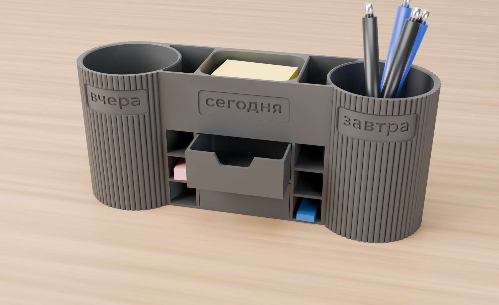
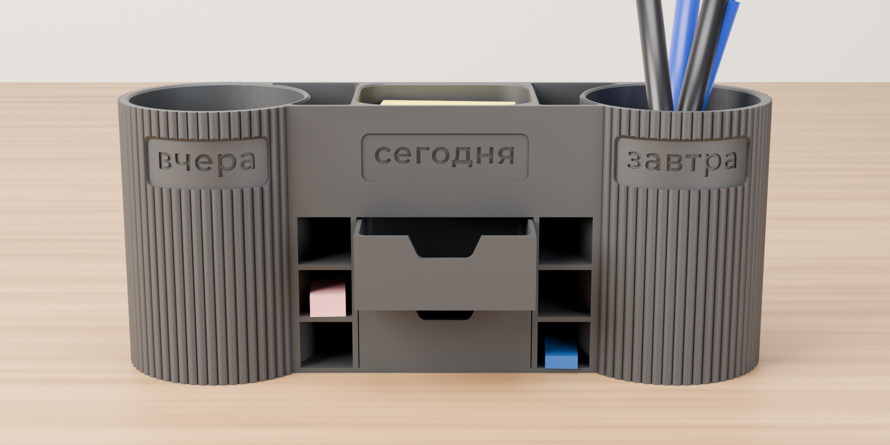
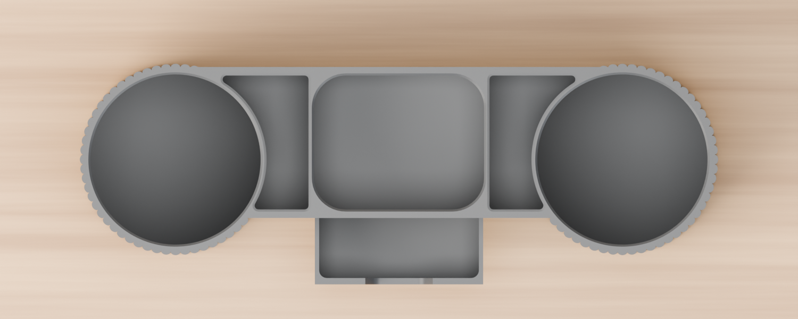
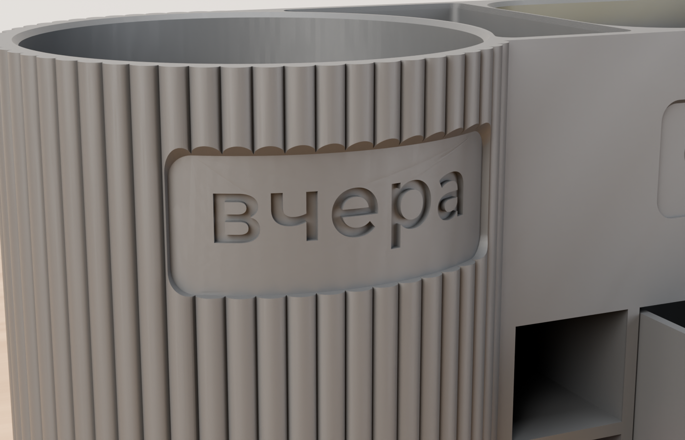
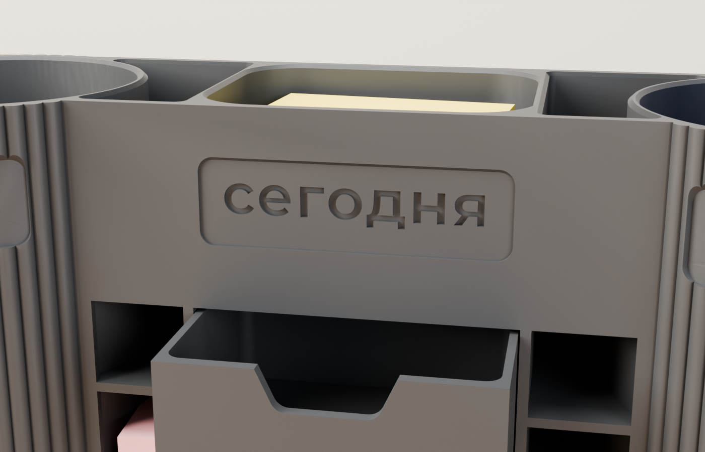
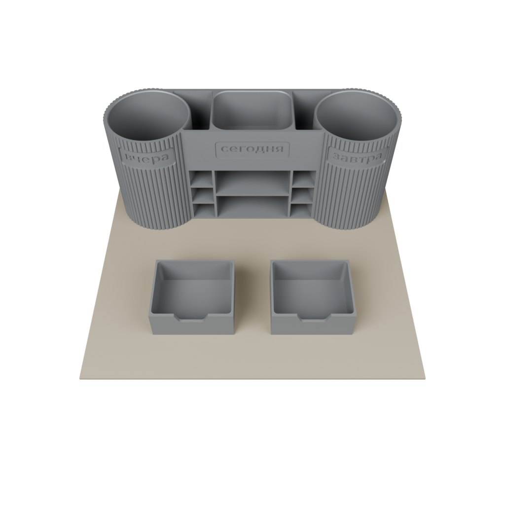
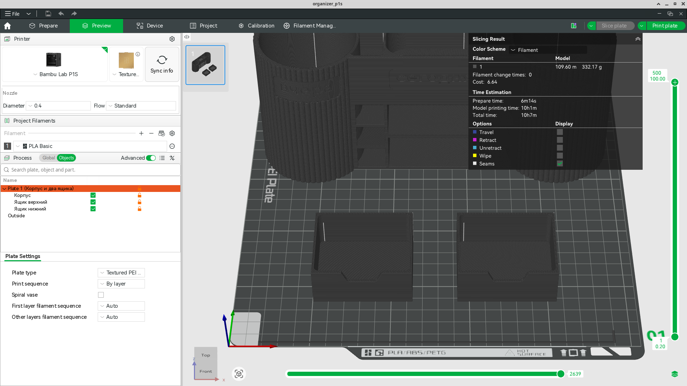

# Органайзер «вчера · сегодня · завтра»

Настольный органайзер: два рифлёных стакана под ручки, между ними блок. Сверху у блока открытый карман и два карманчика, спереди два выдвижных ящика и по бокам от них открытые полочки в три яруса. На каждом отделении своя табличка: слева «вчера», в центре «сегодня», справа «завтра».



Сделан по фото-образцу. Отличия от образца:

- **Рёбра вдвое чаще.** 60 рёбер по кругу вместо примерно 30, шаг 3,8 мм, высота 1,2 мм. Вершины скруглены, впадины узкие.
- **Надписи.** Montserrat SemiBold, строчные, без засечек, высота строчных 6 мм. Буквы утоплены на 0,8 мм в гладкие таблички. На стаканах таблички врезаны в рёбра и повторяют изгиб стенки, в центре табличка утоплена на 0,6 мм в лицевую стенку. Все три надписи на одной высоте, 82 мм от стола.
- **Габарит 240 мм**, чтобы корпус целиком встал на стол P1S.
- **Внутри нет глухих объёмов.** Место между ящиками и стаканами отдано под полочки для мелочей: по три яруса с каждой стороны, открыты спереди. Над ними, по бокам от кармана, два карманчика. Ящики из-за этого уже: 60 мм внутри вместо 80.

| | |
|---|---|
| Габарит | 240 × 72 × 100 мм |
| Стаканы | Ø72 по рёбрам, Ø64 внутри, глубина 97,6 мм |
| Карман сверху | 64 × 50 × 36 мм |
| Карманчики сверху | два, по 1000 мм² в плане, глубина 36 мм |
| Ящик | снаружи 63,3 × 53,9 × 26,5 мм, внутри 60 × 50 × 25 мм |
| Полочки | 2 × 3 яруса, проём спереди 19,5 мм, высота яруса 17,8 мм, глубина 54 мм; внутри шире, вдоль стакана |
| Печать | один стол P1S, PLA, ≈ 10 ч, ≈ 332 г, без поддержек |

| Спереди | Сверху |
|---|---|
|  |  |
| **«вчера» крупно** | **«сегодня» крупно** |
|  |  |

## Файлы

Пути — от папки `desk-organizer/`.

| Путь | Что это |
|---|---|
| `print/organizer_p1s.3mf` | Проект Bambu Studio под P1S: корпус и два ящика на одном столе, профили, настройки деталей |
| `stl/organizer_body.stl` | Корпус, в положении для печати |
| `stl/organizer_drawer.stl` | Ящик, в положении для печати (нужно два) |
| `cad/organizer.py` | Параметрическая модель: все размеры и надписи в `Params` |
| `cad/build.py` | Сборка STL, GLB и проекта P1S, проверки, отчёт |
| `cad/bambu_project.py` | Запись проекта Bambu Studio, пересохранение с полными профилями и нарезка через CLI |
| `cad/flat_presets.py` | Плоские профили P1S / 0.20mm Standard / PLA Basic из профилей Bambu Studio |
| `cad/render_blender.py` | Рендеры в `docs/renders` (Blender, Cycles) |
| `cad/fonts/` | Шрифт Montserrat SemiBold и его лицензия SIL OFL |
| `print/presets/` | Плоские профили для CLI Bambu Studio |
| `docs/report.json` | Отчёт последней сборки: размеры, стенки, пересечения, свесы, мосты, раскладка, нарезка |
| `docs/viewer/organizer.glb` | Сборка для 3D-просмотра, верхний ящик выдвинут |

## Печать на Bambu Lab P1S

Откройте [`print/organizer_p1s.3mf`](print/organizer_p1s.3mf) в Bambu Studio: «Файл → Открыть проект». Корпус и оба ящика уже стоят на столе как надо. Остаётся выбрать слот AMS с PLA и нажать «Нарезать».



**Профили.** Принтер «Bambu Lab P1S 0.4 nozzle», процесс «0.20mm Standard @BBL X1C», пруток «Bambu PLA Basic @BBL P1S 0.4 nozzle», стол Textured PEI Plate. Профили записаны в проект целиком, поэтому Studio показывает их как системные, без правок. Если пруток другой, выберите его профиль в слоте: раскладка и настройки деталей сохранятся.

**Настройки деталей** заданы поверх процесса, их видно в списке объектов:

| Деталь | Стенки | Шов | Ещё |
|---|---|---|---|
| Корпус | 3, генератор Arachne | сзади | заполнение 20 %, толстые мосты |
| Ящики | 4 — стенка 1,6 мм выходит сплошной | сзади | |

Bambu Studio 2.08 режет стол за 10 ч 07 мин и 332 г PLA, без предупреждений и без смен прутка.

Время съедают стенки и перемещения, а не заполнение: редкая сетка 20 % — меньше 2 ч из 10. Полочки вместо сплошного объёма времени не экономят: у них свои стенки и перекрытия, итог +15 минут. Главное здесь — генератор стенок Arachne. Стенка стакана 2,8 мм не делится на 3 + 3 обычных периметра, классический генератор забивает остаток сплошными зигзагами с перемещениями, и стол без полочек шёл 12,9 ч против 9 ч 51 мин.



- Поддержки не нужны. Верхние кромки табличек скошены под 45°, буквы утоплены всего на 0,8 мм.
- Потолки двух ниш ящиков печатаются мостом 64 мм, полочки — мостами до 34 мм с опорой на три стороны. Над ящиком оставлен запас 1 мм на провис. Если ящик всё же трёт по потолку, снимите провис ножом или соберите заново с `--set gap_top=1.5`.
- Корпус стоит надписями к дверце принтера, шов уходит на заднюю стенку.
- PETG тоже подойдёт: выберите его профиль в слоте. Мосты у PETG провисают сильнее, лучше взять `gap_top=1.5`.

На другом принтере берите STL из `stl/`: они уже в положении для печати. Слой 0,2 мм, у корпуса 3 стенки с генератором Arachne и заполнение 20 %, у ящиков 4 стенки.

## Пересборка с другими размерами

```bash
cd desk-organizer
pip install -r requirements.txt
python3 cad/build.py                                   # STL, GLB, проект P1S, docs/report.json
python3 cad/build.py --set rib_n=72                    # рёбра ещё чаще
python3 cad/build.py --set word_left="было" --set word_right="будет"
python3 cad/build.py --render --bambu bambu-studio     # плюс рендеры Blender и нарезка в Bambu Studio
```

Основные параметры `Params` в `cad/organizer.py`:

- `rib_n`, `rib_h`, `rib_shape`: число рёбер, высота, профиль (1 — синус, меньше — круглее вершина).
- `word_left`, `word_center`, `word_right`: надписи. `x_height` — высота строчных, `track` — разрядка, `text_depth` — глубина букв, `text_z` — высота строки над столом.
- `cup_r`, `cup_pitch`, `height`: радиус стакана по рёбрам, расстояние между осями, высота. Габарит = `cup_pitch + 2 × cup_r`.
- `gap_side`, `gap_top`, `gap_back`: зазоры ящика в нише. `bay_w` и `pocket_w` — ширина ниши ящиков и кармана: чем они уже, тем шире полочки и карманчики.
- `side_tiers`, `side_shelf`: число ярусов полочек и толщина полки. `bore_wall_min` — наименьшая стенка от полочек до отверстия стакана.

Длинное слово на стакане упрётся в стык с центральным блоком. Сборка считает запас для каждой таблички (`надписи → запас_до_стыка_с_блоком_град` в отчёте): он должен оставаться положительным. Сейчас у «завтра» 10°.

Без `--bambu` проект пишется только с именами профилей. CLI Bambu Studio такой проект режет со значениями по умолчанию (стенки 60 мм/с), поэтому для готового проекта нужен `--bambu`: он пересохраняет проект с плоскими профилями из `print/presets/` и записывает время и граммы в отчёт. Профили для другой версии Studio: `python3 cad/flat_presets.py <BambuStudio>/resources/profiles/BBL print/presets`.

## Проверки в отчёте

- Пересечения ящиков с корпусом в нишах: оба 0 мм³.
- Стенки: от полочек и карманчиков до отверстия стакана 2,2 мм, перегородки у ниши ящиков и кармана 2 мм, под буквами на стаканах и в центре 1,8 мм.
- Полочки и карманчики нигде не выходят наружу, кроме проёма спереди: 0 мм³ ближе 1,5 мм к внешней поверхности.
- Свесы в положении для печати: круче 45° только мелкие потолки букв (самый широкий 2,1 мм) и мосты: потолки ниш ящиков 64 × 54 мм и полочек 34 × 54 мм.
- Раскладка на столе P1S: в пределах 256 × 256, мимо угла срезки прутка, зазоры между деталями от 5 мм.
- Нарезка в Bambu Studio CLI: время, граммы, предупреждения. CLI и GUI сходятся: 10,2 ч и 10 ч 07 мин.
